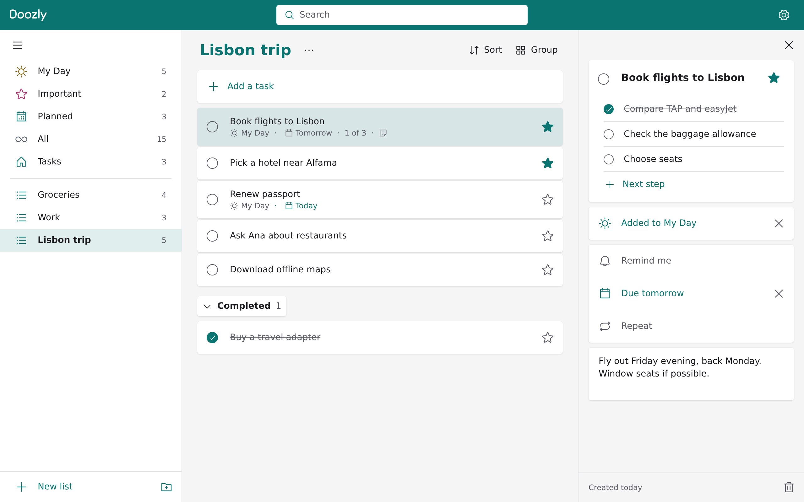
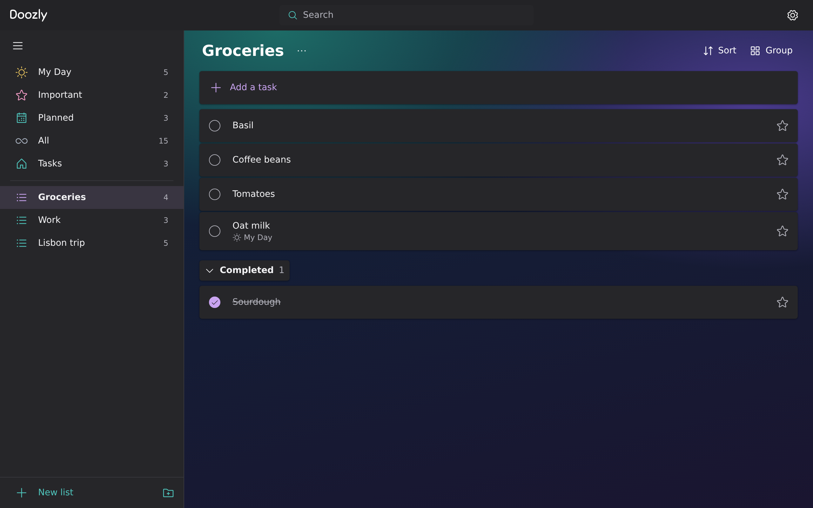
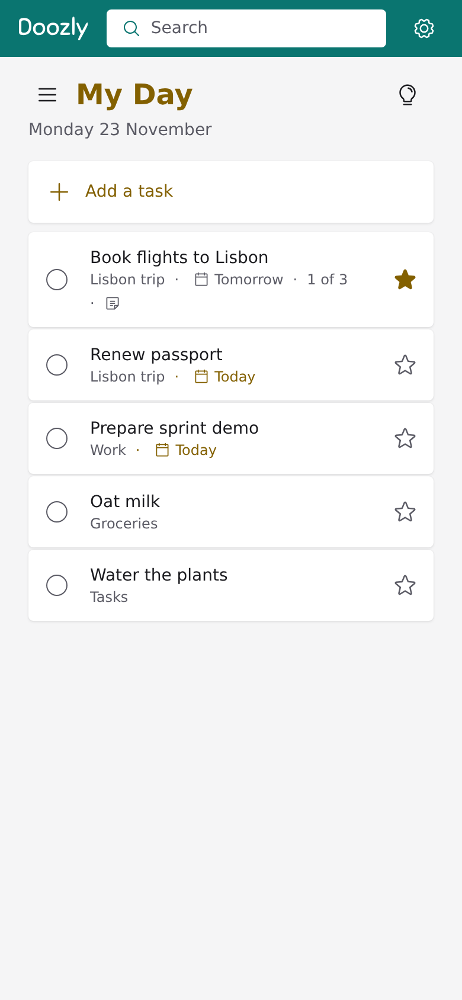

# Doozly

A local-first to-do app for the web and desktop. Your tasks live in your browser, and sync through your own Google Drive or OneDrive. There is no Doozly server holding your data.

Doozly is modelled on the layout and behaviour of Microsoft To Do. It is an independent project and is not affiliated with or endorsed by Microsoft.



Lists, My Day, Important and Planned, steps, notes, due dates, reminders and repeats. Themes for every list, dark mode, works offline and there is also a desktop app for Linux, macOS and Windows.

<p>
  
  &nbsp;
  
</p>

## Requirements

- Node.js 24 or later
- pnpm, via Corepack: `corepack enable pnpm`

## Getting started

```sh
pnpm install
pnpm dev
```

The dev server prints its local URL (usually http://localhost:5173).

## Scripts

| Command           | What it does                                           |
| ----------------- | ------------------------------------------------------ |
| `pnpm dev`        | Start the dev server with hot reload                   |
| `pnpm build`      | Typecheck and build to `dist/`                         |
| `pnpm preview`    | Serve the production build locally                     |
| `pnpm typecheck`  | Run the TypeScript compiler without emitting           |
| `pnpm lint`       | Check linting and formatting with Biome                |
| `pnpm format`     | Apply Biome's fixes and formatting                     |
| `pnpm test`       | Run the unit and component tests once (Vitest)         |
| `pnpm test:watch` | Run Vitest in watch mode                               |
| `pnpm e2e`        | Build, serve and run the end-to-end tests (Playwright) |

Before the first end-to-end run, install the browsers:

```sh
pnpm exec playwright install chromium firefox webkit
```

## Tech stack

React 19 and TypeScript on Vite, with the React Compiler. Biome for linting and formatting, Vitest and Testing Library for unit tests, Playwright for end-to-end tests in Chromium, Firefox and WebKit.

## Git hooks

`pnpm install` sets up a pre-commit hook that runs Biome on staged files and a full typecheck. If you keep a personal hook of your own, put it in `.git/hooks/pre-commit.local` and make it executable. It runs before the project checks.

CI runs the typecheck, lint, unit tests, build and end-to-end tests on every push and pull request.
